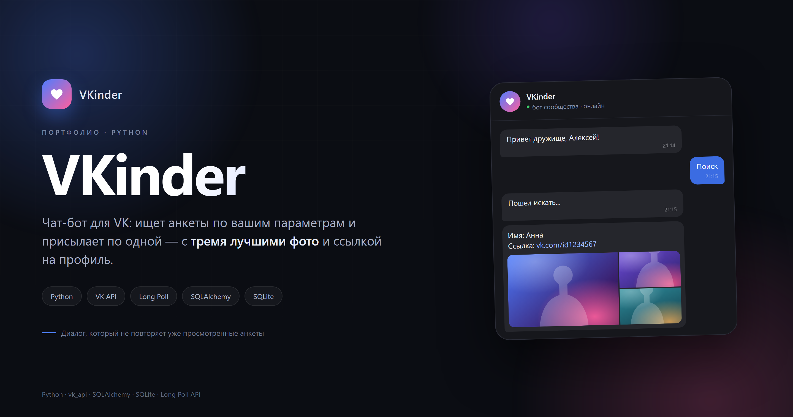
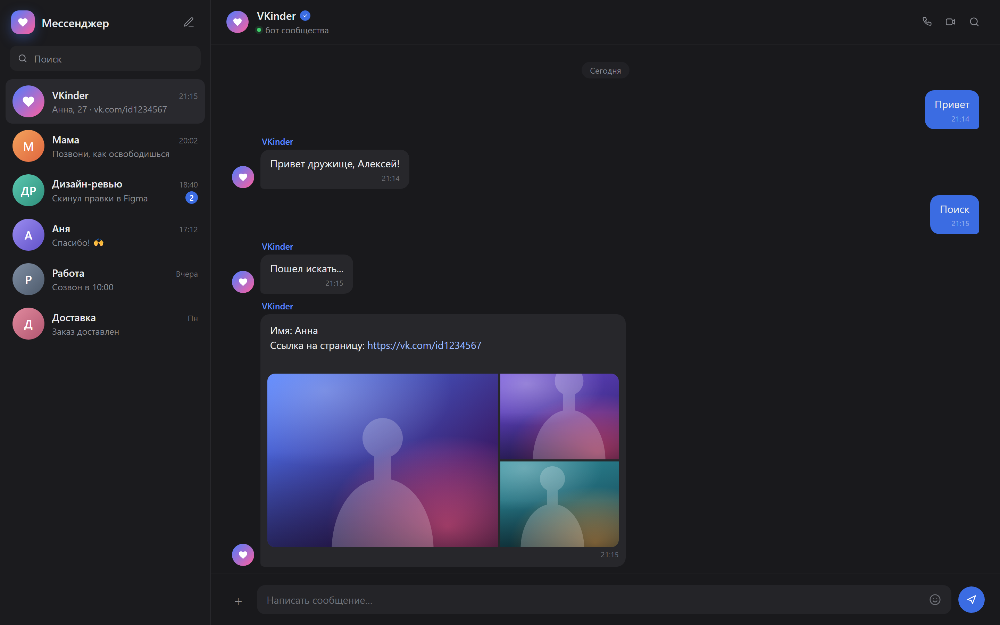
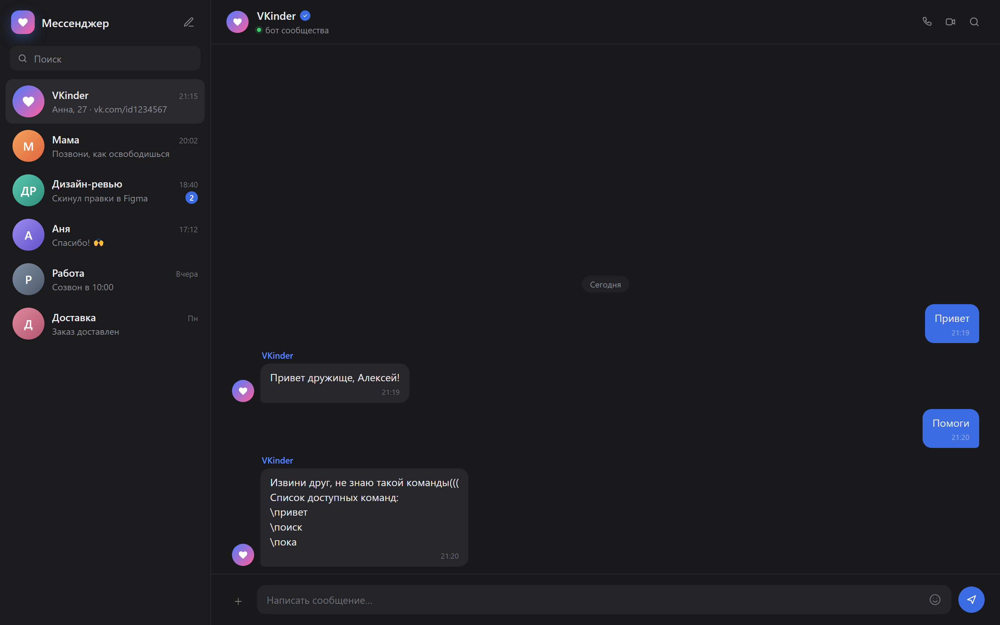
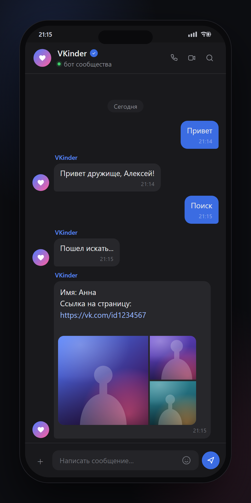
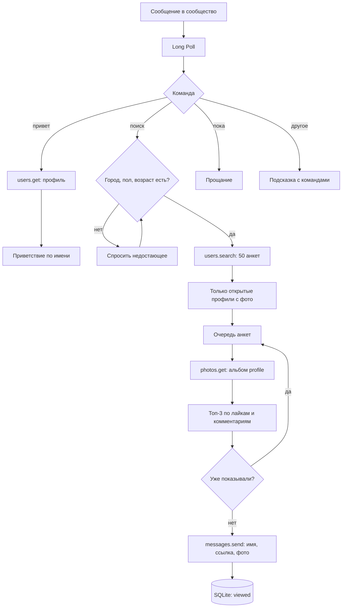

# VKinder — чат-бот поиска анкет для VK

Чат-бот сообщества VK: ищет людей по заданным параметрам и присылает анкеты прямо
в диалог — по одной, с именем, ссылкой на профиль и тремя фотографиями,
отсортированными по лайкам и комментариям. Недостающие данные бот запрашивает сам,
а просмотренные анкеты сохраняет в SQLite, чтобы не повторяться.



Проект вырос из дипломной работы курса «Python-разработчик». Это рабочий прототип:
запускается локально и требует токенов VK. Сценарий целиком — от сообщения в
сообщество до записи просмотренной анкеты в базе.

## Что делает бот

- Здоровается по имени из профиля VK.
- Ищет анкеты противоположного пола: город из профиля, возраст ±3 года, только
  открытые профили с фотографиями и статусом «в активном поиске».
- Если в профиле не хватает данных для поиска, спрашивает их в диалоге.
- Присылает по одной анкете: имя, ссылку и три лучших фото.
- Считает «лучшие» по сумме лайков и комментариев, а не по дате загрузки.
- Хранит пары «пользователь — анкета» в SQLite и не показывает тому же
  пользователю одну анкету дважды.
- Понимает команды `привет`, `поиск`, `пока`; на неизвестное сообщение отвечает
  подсказкой.

## Демонстрация



*Приветствие, запуск поиска и анкета с тремя фотографиями.*



*Запасной сценарий: бот не теряет пользователя и показывает список команд.*



*Тот же сценарий в мобильном мессенджере.*

> **Важно:** изображения — макет интерфейса VK, собранный по реальным сценариям
> бота. Живой диалог требует токенов сообщества и пользователя, поэтому для
> портфолио сценарий воспроизведён вёрсткой: тексты сообщений и порядок шагов
> взяты из кода, фотографии анкет заменены абстрактными заглушками.

## Как это работает



## Почему так устроено

- **Long Poll вместо Callback API.** Боту не нужен публичный HTTPS-адрес: он сам
  опрашивает VK. Проект запускается локально, без публикации сервера.
- **Очередь по 50 анкет.** `users.search` вызывается пачками, `offset` сдвигается
  на 50; следующая пачка запрашивается, когда очередь опустела.
- **Дедупликация на уровне БД.** Составной первичный ключ
  `(profile_id, worksheet_id)` не даёт показать анкету повторно тому же
  пользователю и переживает перезапуск бота.
- **Ранжирование фото.** Вместо первых трёх из альбома — сортировка по
  `likes + comments`: в диалог попадают фото, которые уже заинтересовали других.
- **Диалоговый онбординг.** Профиль VK часто заполнен частично; перед поиском бот
  дозапрашивает недостающие поля.

## Стек

| Слой | Технологии |
| --- | --- |
| Язык | Python 3.9+ (проверено на 3.14) |
| VK | VK API через `vk_api`: Long Poll, `users.get`, `users.search`, `photos.get` |
| Хранение | SQLAlchemy 2.x, SQLite |
| Утилиты | `datetime` для возраста, `pprint` |

Веб-фреймворк не нужен: бот общается с VK через Long Poll и не принимает HTTP-запросы.

## Запуск

Нужен Python 3.9 или новее.

1. Установите зависимости:

   ```bash
   pip install -r requirements.txt
   ```

2. Получите токен сообщества с доступом к сообщениям и токен пользователя VK —
   инструкция в [репозитории курса](https://github.com/netology-code/py-advanced-diplom/blob/new_diplom/group_settings.md).
3. Скопируйте шаблон конфигурации и заполните токены:

   ```bash
   cp config.example.py config.py
   ```

   В Windows та же команда: `copy config.example.py config.py`.

4. Запустите бота:

   ```bash
   python interface.py
   ```

5. Напишите сообществу `привет`. Бот работает, пока запущен процесс; файл
   `viewed.db` создастся автоматически.

## Структура проекта

```
VKinder/
├── interface.py        # Long Poll, обработка команд, сценарий диалога
├── main.py             # VkTools: users.get, users.search, photos.get, возраст
├── data_base.py        # модель Viewed и проверка просмотренных анкет
├── config.example.py   # шаблон конфигурации
├── requirements.txt
├── docs/
│   ├── screenshots/    # изображения для README
│   └── mockups/        # HTML-исходники макетов
└── README.md
```

`config.py` и `viewed.db` перечислены в `.gitignore`; шаблон конфигурации лежит в
`config.example.py`.

## Ограничения и планы

Проект небольшой, поэтому честно фиксирую, что в нём пока не так:

- **Один поток Long Poll.** Пока бот ждёт ответ пользователя, остальные сообщения
  стоят в очереди. Дальше — очередь событий и асинхронная обработка.
- **Сценарий начинается с «привет».** Параметры профиля загружаются только в этой
  команде; отдельной команды «заполнить профиль» нет.
- **Возраст требует доработки.** Дата рождения нужна с годом: если год скрыт,
  `_bdate_to_year` получает `д.м` и падает, а дозапрос возраста содержит рассинхрон
  ключей `age`/`year`. Это первый пункт на исправление.
- **Нет тестов.** Логика поиска и дедупликации проверяется вручную. Следующий шаг —
  `pytest` и фейковый клиент VK API.
- **Обработка ошибок VK API неполная.** `ApiError` перехватывается, но после ошибки
  код всё равно обращается к `items`. Нужна единая обёртка с пустым результатом.

## Автор

Aleksei Barenkov — [GitHub](https://github.com/AlekseiBarenkov).
